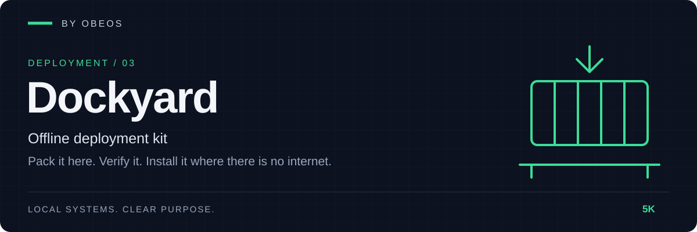

<div align="center">



**Offline deployment kit. Pack an application here, verify it, install it where there is no internet.**

[](https://github.com/5K-bit/Dockyard/actions/workflows/ci.yml)


[](LICENSE)

</div>

[Quick start](#quick-start) · [Demonstration](#demonstration) · [Tests](#tests-and-evidence) · [Limitations](#limitations)

---

## Overview

Dockyard packages a **Docker Compose application with its images** into one file, so it can be installed on another computer **with no internet**. On the target it checks the bundle, loads the images, starts the app and runs your **health checks**.

Part of the OBEOS projects, and it works completely on its own. No server, no account, no registry, no telemetry; it drives the `docker` command already on both machines.

> **Trusted software only.** Docker containers run with the daemon's authority. Dockyard rates the Compose file and refuses obviously dangerous settings unless you accept them, but it is not a sandbox. Checksums inside a bundle catch damage, not tampering: pass the archive digest by a separate route. See [Limitations](#limitations).

## Demonstration

A real run in the project's test environment, on one Linux machine with Docker, using the small Go service in [`examples/demo-app`](examples/demo-app). The second "machine" is simulated: the image and containers are deleted, the bundle is unpacked into a fresh directory, and a virtual environment without Dockyard runs the `dockyard.pyz` that travels inside the bundle. (Excerpt; full transcript in [docs/evidence](docs/evidence/).)

```text
$ dockyard pack --out dist
saving dockyard-demo/api:1.0
Bundle: dist/demo-1.0.0.dockyard (4.6 MB)
SHA-256: 1336bea467d8dc7992b7a89489f0735f3eaa1d16ec118a69fc5757509b24a018
Give the SHA-256 to the person installing, by a different route than the file.

$ python dockyard.pyz install demo-1.0.0 --dir install
verified demo 1.0.0 (5 files, 8.2 MB)
loading dockyard-demo/api:1.0
starting
checking health
  health api: http://127.0.0.1:18080/health: status 200 (0.0s)
  health api-container: api: running (0.1s)
demo 1.0.0 installed and running in install
```

A corrupted copy is refused before anything is loaded, and so is a bundle whose digest is not the one you were given:

```text
$ dockyard install tampered.dockyard --dir install2
dockyard: verification failed: checksum mismatch: images/dockyard-demo_api_1.0.tar
[exit 2]
$ docker images -q dockyard-demo/api:1.0
(nothing: no image was loaded)
```

Reproduce it (needs Docker and Go): `python examples/acceptance.py --out /tmp/evidence`.

## Quick start

**Requirements:** Python 3.11 or newer; Docker with the Compose plugin on both machines.

On the machine **with internet**:

```bash
git clone https://github.com/5K-bit/Dockyard && cd Dockyard
pip install .                      # no other dependencies
cd /path/to/your/app               # a compose.yaml where every service names an image
dockyard init                      # writes a starter dockyard.toml; edit the name, version and health checks
dockyard pack --out dist           # prints the archive SHA-256
```

Copy `dist/<name>-<version>.dockyard` (and note the SHA-256) to the target by any route you like. On the machine **without internet**, with only Python and Docker:

```bash
# 1. Check the archive with a system tool BEFORE unpacking or running anything from it
echo "<sha256 you were given>  myapp-1.0.0.dockyard" | sha256sum -c -    # macOS: shasum -a 256 -c -
# 2. Only if that printed "OK":
tar -xzf myapp-1.0.0.dockyard
python myapp-1.0.0/dockyard.pyz install myapp-1.0.0.dockyard --dir /opt/myapp --digest <sha256>
python myapp-1.0.0/dockyard.pyz status --dir /opt/myapp
```

The bundled `dockyard.pyz` is code from the bundle, so it must not be what checks the bundle: the first step uses `sha256sum`, which is already on the machine. `install --digest` repeats the check and records it.

A `dockyard.toml` looks like this:

```toml
[app]
name = "demo"
version = "1.0.0"
compose = "compose.yaml"

[[health]]
name = "api"
kind = "http"
url = "http://127.0.0.1:18080/health"
expect_status = 200
timeout = 30

[[health]]
name = "api-container"
kind = "container"
service = "api"
```

| Command | Purpose |
|---|---|
| `init [--dir]` | Write a starter `dockyard.toml` |
| `pack [--config --out --pull/--no-pull]` | Bundle images, Compose file and extras; write the archive and its `.sha256` |
| `verify BUNDLE [--digest]` | Check an archive or unpacked directory; nothing is installed |
| `install BUNDLE --dir D [--digest --accept-risks --allow-command-checks --no-start --skip-health --upgrade --project]` | Verify, audit, load, start, health-check |
| `health --dir D` | Re-run an installed app's health checks |
| `status --dir D` | Show the install and its containers |
| `uninstall --dir D [--remove-images --volumes]` | Stop the app; optionally remove images or data |

Health check kinds: `http` (status and optional body; redirects are not followed), `tcp`, `container` (service is running) and `command` (off unless `--allow-command-checks`). Exit codes: 0 ok, 1 error, 2 verification failure, 3 health failure.

## Architecture

```
dockyard.toml ─► pack ─► bundle (.dockyard) ═══ USB / share ═══► verify ─► install ─► health
                  │       manifest · SHA256SUMS                      │         │
                  │       compose.yaml · images/*.tar                │         ├─ risk audit (docker compose config)
                  │       dockyard.pyz · INSTALL.txt                 │         ├─ docker load + image ID check
                  └─ docker save                                     │         └─ up --no-build --pull never
                                                                     └─ safe extraction + checksums + digest
```

Details: [docs/architecture.md](docs/architecture.md) · [threat model](docs/threat-model.md) · decisions in [docs/adr/](docs/adr/).

## Tests and evidence

```bash
pip install -e ".[dev]"
ruff check . && ruff format --check . && mypy
python -m pytest --cov
```

The last recorded run (Linux, Python 3.13) is in [docs/evidence/test-run.txt](docs/evidence/test-run.txt). What each claim rests on:

| Claim | Evidence |
|---|---|
| The manifest is validated strictly and its format is pinned | [`tests/unit/test_manifest.py`](tests/unit/test_manifest.py) with a [golden file](tests/fixtures/manifest.golden.json) |
| Packing is deterministic given `SOURCE_DATE_EPOCH`; archives with traversal, links, duplicates or oversized contents are refused; altered files are detected | [`tests/unit/test_bundle.py`](tests/unit/test_bundle.py) |
| Install order, platform and image-ID checks, upgrade rules, and that a failed verification loads nothing | [`tests/unit/test_install.py`](tests/unit/test_install.py) |
| Risky Compose settings are rated and stop the install | [`tests/unit/test_config_risks.py`](tests/unit/test_config_risks.py) |
| Health checks (http, tcp, container, command) and retry | [`tests/unit/test_health.py`](tests/unit/test_health.py) |
| CLI behaviour and exit codes | [`tests/integration/test_cli.py`](tests/integration/test_cli.py) |
| It works against a real Docker daemon | [`tests/integration/test_real_docker.py`](tests/integration/test_real_docker.py) (skipped without a daemon), [transcript](docs/evidence/acceptance-transcript.txt) |

## Limitations

Dockyard does not claim more than it has shown:

- **Verified on one machine.** The real-Docker scenario ran on one Linux host with the "second machine" simulated by a clean directory and virtual environment. It has not been run between two physical computers, and not against anything but a toy single-container app.
- **Checksums do not stop an attacker.** Without `--digest`, a consistently rewritten bundle passes. Bundles are not signed or encrypted in this version.
- **The risk audit is a guard rail.** It knows a list of dangerous settings, not every way a container can misbehave.
- **Compose and images only.** Every service needs an `image:`. No Kubernetes, no Podman, no Swarm, no registry mirrors.
- **Same platform required.** Images must match the target's OS and CPU architecture; nothing is converted.
- **Windows is untested by hand.** CI runs the unit tests on Windows. Docker Desktop installs have not been tried.
- **Docker is trusted.** Image IDs and `docker load` behaviour are taken from Docker.
- **Packing needs the images locally** (or a registry, when you pack with `--pull`).

## Roadmap

- [x] Pack, verify, install, health-check one Compose application offline
- [ ] Run on GitHub CI (Linux and Windows) and confirm the matrix and the real-Docker job are green
- [ ] Sign bundles with a key you hold
- [ ] Multi-architecture bundles
- [ ] Differential bundles for upgrades
- [ ] Rollback to the previous install
- [ ] Record installs in OBEOS manifests (optional OBEOS integration)

## Development practice

AI tools assist with implementation, debugging, tests and documentation in this project.
Louis Boddie owns direction and acceptance decisions; the linked tests and [evidence](docs/evidence/) document what is verified.

## Contributing

Issues and pull requests are welcome. See [CONTRIBUTING.md](CONTRIBUTING.md) and [SECURITY.md](SECURITY.md).

## License

[Apache-2.0](LICENSE) © 5K-bit
